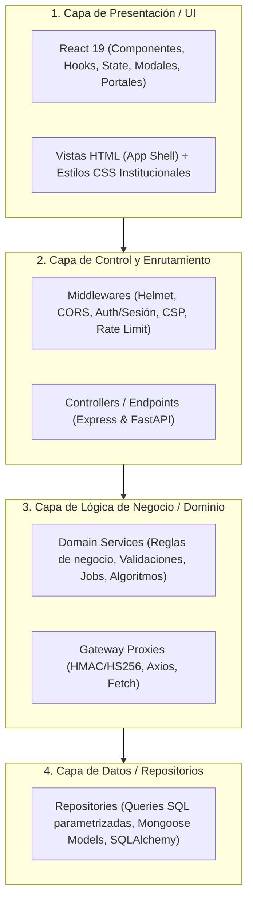

# Software de Prácticas Pedagógicas (SPP)

Plataforma integral para la administración, acompañamiento, seguimiento y evaluación de las Prácticas Pedagógicas Universitarias. Diseñada bajo una arquitectura híbrida de **Monolito Modular** complementado con **Microservicios especializados**, garantizando alta cohesión, escalabilidad, seguridad y una experiencia de usuario moderna basada en componentes React.

---

## 🏛️ Arquitectura General del Software

El ecosistema de SPP está compuesto por tres componentes principales comunicados mediante HTTP/REST seguro (tokens HMAC/HS256 y API Keys):

```mermaid
flowchart TD
    subgraph Cliente ["🖥️ Navegador Web / Cliente"]
        UI["Frontend React 19 (Vite)\nBundles en public/dist/"]
    end

    subgraph Monolito ["🏢 Monolito SPP (Node.js / Express :3000)"]
        Routes["Router & Middlewares (Auth, CSP, Helmet)"]
        Controllers["Controllers (MVC)"]
        Services["Business Services (Auth, Practice, Reports, Export)"]
        Repos["Data Repositories"]
        Routes --> Controllers --> Services --> Repos
    end

    subgraph MicroEvaluacion ["📝 Servicio de Evaluación (FastAPI :8000)"]
        FastAPI["API REST FastAPI / Uvicorn"]
        EvalEngine["Motor de Cuestionarios, Intentos y Calificación"]
        FastAPI --> EvalEngine
    end

    subgraph MicroNotif ["🔔 Servicio de Notificaciones (Express :4000)"]
        NotifApp["Dispatcher & Scheduler"]
        MailWorker["Nodemailer (SMTP / Gmail)"]
        NotifApp --> MailWorker
    end

    subgraph Persistencia ["💾 Capa de Persistencia y Almacenamiento"]
        PostgreSQL[("PostgreSQL / Supabase\n(Datos relacionales, prácticas, usuarios)")]
        MongoDB[("MongoDB\n(Historial notificaciones y logs)")]
        Cloudinary[("Cloudinary\n(Almacenamiento de evidencias y PDFs)")]
    end

    UI -->|HTTP / JSON + Session| Routes
    Repos --> PostgreSQL
    Repos --> Cloudinary
    Services -->|Proxy Gateway Seguro (HMAC)| FastAPI
    Services -->|Disparo de Eventos| NotifApp
    FastAPI --> PostgreSQL
    NotifApp --> MongoDB
    NotifApp -.->|Consulta sondeo 24h| Routes
```

---

## 🏗️ Arquitectura en Capas (Layered Architecture)

Cada servicio y en particular el Monolito (`SOFTWARE_SPP`) implementa una separación estricta en capas desacopladas:



1. **Capa de Presentación (UI)**: Código fuente React 19 empaquetado con Vite en `SOFTWARE_SPP/frontend/src`. Utiliza `createPortal` para integrarse con el shell HTML existente sin colisiones ni fuga de estilos.
2. **Capa de Control**: Rutas y controladores Express / FastAPI. Se limitan a validar el payload entrante, orquestar la llamada a la capa de servicio y estructurar la respuesta JSON.
3. **Capa de Negocio / Servicios**: Reglas de negocio puras (asignación de prácticas, cómputo de horas, agregación de reportes de acreditación, generador de cuestionarios y cálculo de notas).
4. **Capa de Acceso a Datos (Repositorios)**: Abstracción de base de datos mediante el patrón *Repository*. Toda consulta SQL se ejecuta de forma estrictamente parametrizada (`$1, $2...`) previniendo cualquier inyección SQL.

---

## 🔄 Transacciones: Atomicidad (ACID) vs. Consistencia Eventual

El sistema utiliza un modelo de concurrencia y persistencia híbrido adaptado a la naturaleza distribuida de la plataforma:

### 1. Atomicidad Estricta (ACID) — Persistencia Local
Aplica en operaciones críticas que involucran integridad de datos relacionales en **PostgreSQL**:
- **Monolito (`SOFTWARE_SPP`)**: Implementado en [`src/repositories/base.repository.js`](file:///c:/Users/EdwinPruebas/OneDrive/Documentos/VSCODE/proyecto/SPP/SOFTWARE_SPP/src/repositories/base.repository.js) mediante el helper `transaction(fn)`. Ejecuta bloques `BEGIN ... COMMIT / ROLLBACK` asegurando que la creación de prácticas, asignación de usuarios y bitácoras sean operaciones atómicas indivisibles.
- **Servicio de Evaluación (`servicio_evaluacion`)**: Envíos de intentos (`submit`), calificación de preguntas e inserción de respuestas se confirman en una sola transacción atómica gestionada por SQLAlchemy.

### 2. Consistencia Eventual — Comunicación Inter-Servicios
Aplica en la orquestación distribuida asíncrona:
- **Despacho de Notificaciones**: Cuando una acción ocurre en el monolito (ej. actividad evaluada o asignada), el monolito persiste el cambio inmediatamente (ACID) y notifica vía HTTP al microservicio de notificaciones.
- **Cola Idempotente y Scheduler**: El microservicio encola la tarea en MongoDB (`dispatcher.service.js`) con una clave única (`key`). Si el servicio de correos o la red experimenta latencia, el planificador reintenta el despacho sin duplicar mensajes (**Eventual Consistency con Idempotencia garantizada**).

---

## 🗄️ Quanta Arquitectónico y Estrategia de Base de Datos (Database-per-Service)

Un **Quanta arquitectónico** representa una unidad mínima de despliegue con alta cohesión funcional, almacenamiento independiente y acoplamiento reducido. SPP implementa el patrón **Database-per-Service**:

| Quanta / Servicio | Motor de Base de Datos | Tipo de Persistencia | Datos Gestionados | Aislamiento y Acceso |
| :--- | :--- | :--- | :--- | :--- |
| **Monolito (`SOFTWARE_SPP`)** | **PostgreSQL** (Supabase) + **Cloudinary** | Relacional + Storage Blob | Prácticas pedagógicas, usuarios, bitácoras, instituciones, evidencias (URLs y metadatos) y auditoría. | **Exclusivo**: Solo el Monolito tiene credenciales de lectura/escritura sobre estas tablas. |
| **Servicio de Evaluación (`servicio_evaluacion`)** | **PostgreSQL** (Esquema de evaluación) | Relacional | Bancos de preguntas, opciones, intentos de evaluación, respuestas y calificaciones. | **Aislado**: Los demás servicios solo consultan estos datos a través de la API REST autenticada con tokens HMAC/JWT. |
| **Servicio de Notificaciones (`servicio_notificaciones`)** | **MongoDB** | NoSQL Documental | Colección `notificaciones`: cola de correos, estado de entrega, plantillas, logs de eventos e historial de lectura en campana. | **Completamente Autónomo**: Su base de datos MongoDB es 100% privada; ningún otro servicio interactúa directamente con ella. |

> **Principio de Aislamiento**: Ningún servicio realiza consultas SQL/NoSQL directas a la base de datos de otro servicio. Toda interoperabilidad se efectúa exclusivamente a través de contratos de API HTTP internos (`/api/internal/...`).

---

## 📦 Estructura de Módulos y Carpetas

```text
SPP/
├── README.md                      # Documentación general del repositorio raíz
│
├── SOFTWARE_SPP/                  # Monolito principal (Backend MVC + Frontend React)
│   ├── frontend/                  # [VISTA] Código fuente de la interfaz de usuario en React
│   │   ├── src/
│   │   │   ├── components/        # Componentes React (Auth, Practice, Director, Reports, UI)
│   │   │   ├── entries/           # Puntos de montaje Vite (login, register, tutor, student, etc.)
│   │   │   └── utils/             # Puentes y helpers de integración
│   │   ├── package.json           # Dependencias de frontend (React, Vite, Lucide, FontAwesome)
│   │   └── vite.config.js         # Configuración de compilación dirigida a public/dist/
│   │
│   ├── public/                    # Archivos estáticos servidos por Express
│   │   ├── dist/                  # Bundles finales compilados por Vite
│   │   ├── css/                   # Hojas de estilo institucionales
│   │   ├── img/                   # Assets gráficos y logotipos
│   │   ├── pages/                 # Páginas HTML (student.html, tutor.html, advisor.html, director.html)
│   │   ├── index.html             # Vista de Login
│   │   └── register.html          # Vista de Registro de usuarios
│   │
│   ├── src/                       # Backend Express (Arquitectura en capas MVC)
│   │   ├── controllers/           # [CONTROLADOR] Manejo de peticiones y respuestas HTTP
│   │   ├── services/              # [LÓGICA DE NEGOCIO] Casos de uso, validaciones, exportación
│   │   ├── repositories/          # [MODELO / ACCESO A DATOS] Consultas SQL hacia PostgreSQL
│   │   ├── routes/                # Definición de rutas y endpoints de la API
│   │   ├── middlewares/           # Seguridad (CSP, Helmet, CORS, Rate Limit, Supabase Auth)
│   │   ├── db/                    # Pool de conexión a PostgreSQL y migraciones
│   │   └── server.js              # Arranque del servidor Node.js
│   │
│   ├── scripts/                   # Scripts de automatización (start-all.js, seeders, etc.)
│   ├── tests/                     # Suite de pruebas unitarias y de integración E2E
│   └── package.json               # Dependencias del monolito y scripts de construcción
│
├── servicio_evaluacion/           # Microservicio de Evaluaciones y Cuestionarios
│   ├── backend/
│   │   ├── app/
│   │   │   ├── api/               # Endpoints FastAPI agrupados por rol (Estudiante, Tutor, Director)
│   │   │   ├── core/              # Configuración, variables y seguridad de tokens
│   │   │   ├── models/            # Modelos Pydantic y SQLAlchemy
│   │   │   └── services/          # Lógica de cálculo de intentos, preguntas y calificaciones
│   │   ├── requirements.txt       # Dependencias de Python (FastAPI, Uvicorn, psycopg2, Pydantic)
│   │   └── docker-compose.yml     # Contenerización del servicio
│   └── README.md
│
└── servicio_notificaciones/       # Microservicio de Notificaciones y Correo
    ├── src/
    │   ├── config/                # Constantes, plantillas y variables de entorno
    │   ├── infrastructure/        # Conexión a MongoDB y cliente SMTP (Nodemailer)
    │   ├── services/              # Dispatcher de emails, plantillas HTML y cron jobs programados
    │   └── server.js              # Servidor Express independiente (:4000)
    ├── package.json
    └── README.md
```

---

## 🛠️ Tecnologías y Frameworks Utilizados

### 1. Frontend (`SOFTWARE_SPP/frontend`)
- **React 19**: Biblioteca declarativa para la construcción de interfaces reactivas y componentes desacoplados.
- **Vite 6**: Empaquetador y entorno de compilación de ultra-alta velocidad (ES Modules).
- **Portales React (`createPortal`)**: Integración limpia en vistas híbridas existentes sin alterar el diseño ni romper el aislamiento DOM.
- **FontAwesome 6 & Lucide Icons**: Iconografía vectorial institucional.

### 2. Monolito Principal (`SOFTWARE_SPP`)
- **Node.js (v18+) & Express**: Núcleo del servidor, API RESTful y servicio de archivos estáticos.
- **Arquitectura MVC / Capas Limpias**: Separación explícita en Rutas -> Controladores -> Servicios -> Repositorios.
- **Seguridad**:
  - `Helmet` para encabezados HTTP seguros.
  - Políticas de seguridad de contenido estrictas (**Content Security Policy - CSP** con `script-src 'self'`).
  - `express-rate-limit` para prevención de ataques de fuerza bruta.
  - Cookies HTTP-Only con flags `SameSite` y `Secure` para mitigación de XSS/CSRF.
- **Autenticación**: Integración dual con **Supabase Auth** y tokens de sesión basados en roles.
- **Almacenamiento de Archivos**: Integración con SDK de **Cloudinary** para carga y validación de evidencias multimedia y documentos PDF.
- **Generación de Reportes**: Exportadores nativos de datos en formato **CSV**, **XLSX (Excel)** y empaquetado comprimido **ZIP**.

### 3. Servicio de Evaluación (`servicio_evaluacion`)
- **Python 3.11+ & FastAPI**: Framework asíncrono de alto rendimiento para APIs REST.
- **Uvicorn**: Servidor ASGI con soporte de recarga en caliente para desarrollo.
- **Pydantic**: Validación estricta de esquemas de datos y contratos de entrada/salida.
- **Algoritmo de Evaluación**: Gestión de bancos de preguntas (abiertas y de selección múltiple), control de intentos concurrentes y ponderación automática de notas.

### 4. Servicio de Notificaciones (`servicio_notificaciones`)
- **Node.js & Express**: Servidor ligero para recepción asíncrona de eventos de notificación.
- **MongoDB & Mongoose**: Base de datos documental NoSQL para almacenamiento persistente del histórico y estado de lectura de notificaciones.
- **Nodemailer**: Motor de despacho de correos electrónicos vía SMTP con plantillas HTML responsivas.
- **Idempotencia y Planificador de Tareas**: Prevención de duplicados mediante claves únicas (`key`) y sondeo periódico de tareas próximas a vencer.

---

## 👥 Roles del Sistema y Control de Acceso (RBAC)

1. **Estudiante (`student`)**:
   - Consulta de información de su práctica asignada y porcentaje de avance en horas.
   - Subida y gestión de evidencias por cada actividad asignada.
   - Realización de cuestionarios y evaluaciones pedagógicas con feedback en tiempo real.
   - Visualización de observaciones y calificación final en su Bitácora (Logbook).
2. **Tutor Académico (`tutor`)**:
   - Seguimiento integral a los estudiantes asignados.
   - Creación y asignación de actividades con fechas de entrega.
   - Revisión, retroalimentación y calificación de evidencias enviadas.
   - Edición de notas finales y observaciones en la Bitácora del practicante.
3. **Asesor Pedagógico (`advisor`)**:
   - Acompañamiento a nivel de institución educativa.
   - Revisión de evidencias y registro de comentarios y observaciones de acompañamiento.
4. **Director de Prácticas (`director`)**:
   - Gestión integral de usuarios (aprobación de registros, edición, suspensión y borrado).
   - Creación y asignación de prácticas profesionales (vinculación estudiante, tutor, asesor e institución).
   - Mantenimiento de tipos de práctica e instituciones aliadas.
   - Tableros estadísticos globales, indicadores de acreditación institucional y exportación de datos.

---

## 🚀 Puesta en Marcha (Instalación Rápida)

### Requisitos Previos
- **Node.js** >= 18.x
- **Python** >= 3.10
- **PostgreSQL** (o instancia activa en Supabase)
- **MongoDB** (local o MongoDB Atlas)

### 1. Clonar el Repositorio
```bash
git clone https://github.com/tu-usuario/spp.git
cd spp
```

### 2. Configurar Variables de Entorno
Copia los archivos `.env.example` a `.env` en cada módulo:
```bash
cp SOFTWARE_SPP/.env.example SOFTWARE_SPP/.env
cp servicio_evaluacion/backend/.env.example servicio_evaluacion/backend/.env
cp servicio_notificaciones/.env.example servicio_notificaciones/.env
```
> Asegúrate de configurar en `SOFTWARE_SPP/.env` las credenciales de PostgreSQL, Supabase y Cloudinary.

### 3. Instalar Dependencias y Compilar Frontend
```bash
# Instalar dependencias del monolito
cd SOFTWARE_SPP
npm install

# Instalar dependencias y compilar el frontend React
cd frontend
npm install
npm run build
cd ..
```

### 4. Iniciar Todos los Servicios con un Solo Comando
Desde la carpeta `SOFTWARE_SPP`, ejecuta el orquestador automático:
```bash
npm run start:all
```

El script iniciará concurrentemente:
- 🌐 **Monolito SPP**: [http://localhost:3000](http://localhost:3000)
- 📝 **Servicio de Evaluación**: [http://127.0.0.1:8000](http://127.0.0.1:8000)
- 🔔 **Servicio de Notificaciones**: [http://localhost:4000](http://localhost:4000)

---

## 🧪 Pruebas Automatizadas

Para ejecutar la suite de pruebas del backend (unitarias, integración de gateways, exportadores y servicios):

```bash
cd SOFTWARE_SPP
npm test
```

---

## 🔒 Seguridad y Buenas Prácticas
- **Aislamiento de Entorno**: Tokens de servicio independientes para comunicación inter-servicios.
- **Protección contra Inyecciones**: Consultas SQL parametrizadas en todos los repositorios y sanitización estricta de nombres y fórmulas en exportaciones CSV/Excel.
- **Validación de Tipos MIME**: Inspección rigurosa de cabeceras en cargas de archivos para evitar ejecución remota de scripts.
